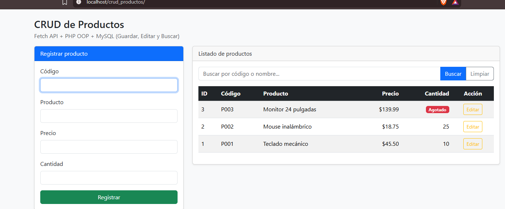
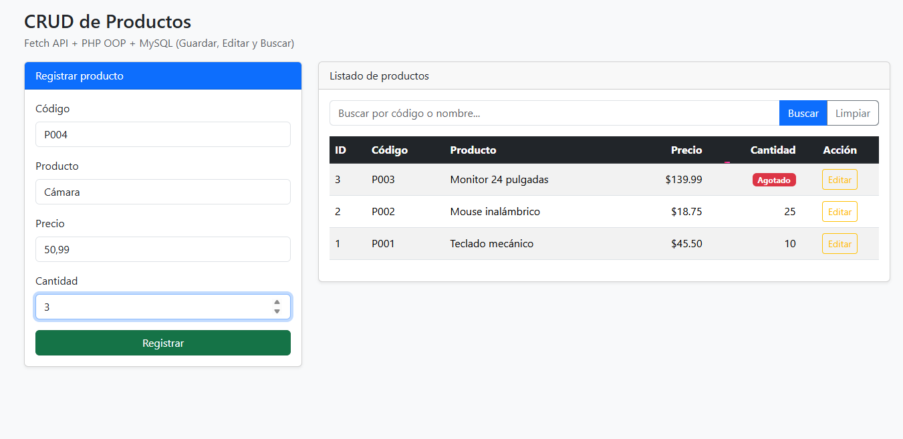
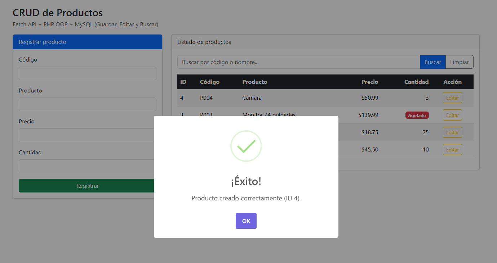
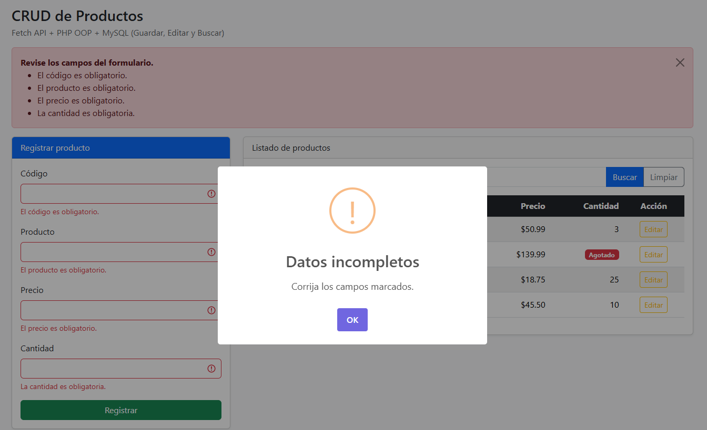
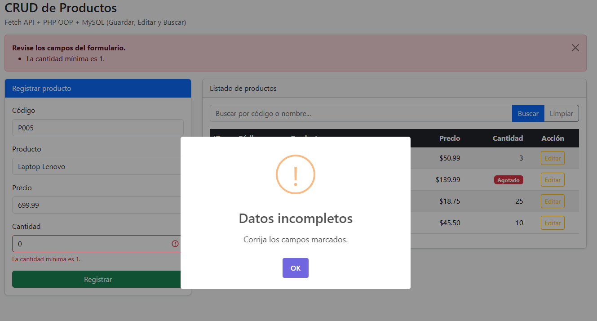
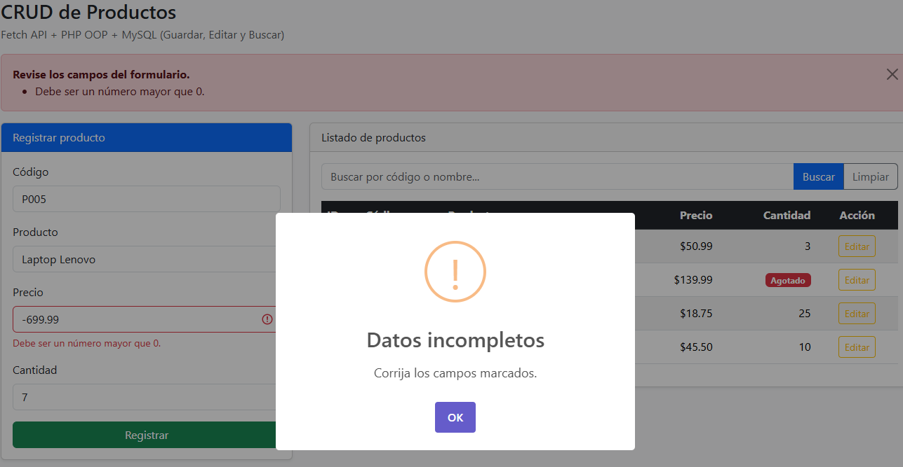
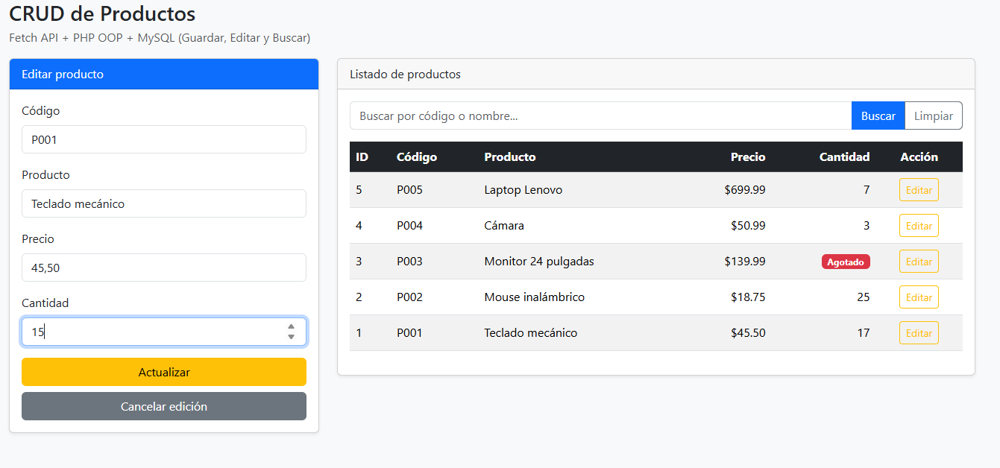
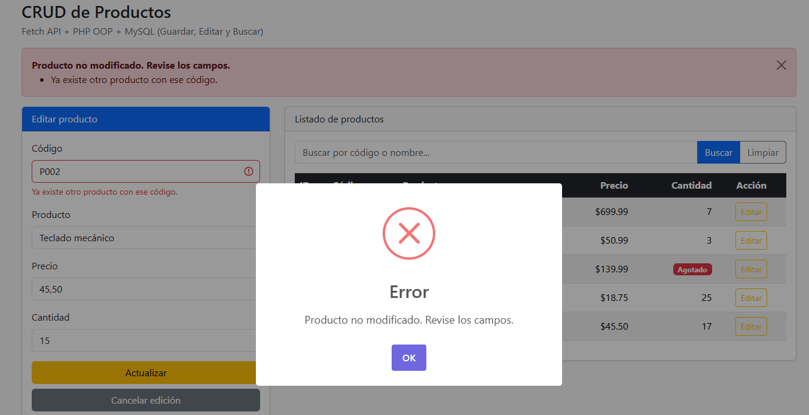
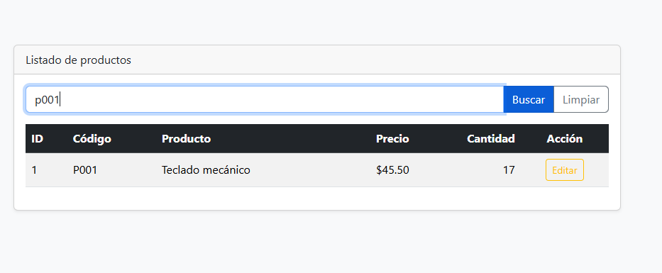
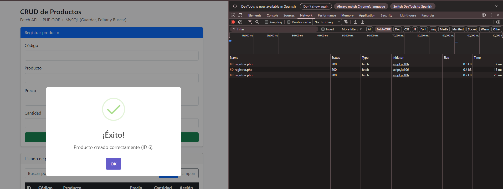

# Laboratorio – CRUD con Fetch API, PHP OOP y MySQL (crud_productos)

## Objetivo

Implementar una aplicación web dinámica bajo la arquitectura cliente-servidor, integrando peticiones asíncronas con **Fetch API** y un backend en **PHP orientado a objetos** con **MySQL (PDO)**, para **guardar, editar y buscar** productos a través de un formulario dinámico, aplicando validaciones en cliente y servidor, respuestas JSON limpias y alertas amigables con **SweetAlert2**.

---

## Requisitos Previos

| Tecnología | Versión / Detalle |
|---|---|
| PHP | 8.x (se usan tipos de unión y `match`-free syntax compatible con 8.0+) |
| WampServer / XAMPP | Entorno de desarrollo local (Apache + MySQL) |
| MySQL / MariaDB | Base de datos `productosdb` |
| Extensión PDO MySQL | `pdo_mysql` habilitada en `php.ini` |
| Visual Studio Code | Editor de código recomendado |
| Navegador | Brave / Chrome / Firefox |
| Conexión a internet | Para cargar Bootstrap 5 y SweetAlert2 desde CDN |

---

## Introducción: Flujo de una petición

Las aplicaciones modernas separan la interfaz (cliente) de la lógica de datos (servidor). El navegador envía los datos del formulario de forma asíncrona, sin recargar la página, y el servidor responde únicamente con **JSON**.

```
Formulario (index.html)
      │  submit
      ▼
script.js ── valida (cliente) ── FormData ── fetch(POST) ──►  registrar.php
                                                                  │
                                                  switch($_POST['Accion'])
                                                                  │
                                                 Clase Producto (validación servidor)
                                                                  │
                                                 Clase DB (PDO, sentencias preparadas)
                                                                  │
                                                              MySQL (productosdb)
                                                                  │
      ◄────────── JSON { success, message, accion, errors, data } ┘
      │
procesarRespuesta() ── switch(data.accion) ── SweetAlert2 + ListarProductos()
```

---

## Estructura del Proyecto

```
crud_productos/
├── index.html          # Formulario (Bootstrap), tabla de productos y buscador
├── script.js           # Eventos, FormData, fetch, switch y SweetAlert2
├── registrar.php       # Controlador: switch($_POST['Accion']) -> respuesta JSON
├── productosdb.sql     # Script de la base de datos y la tabla
├── README.md           # Este documento
├── caps/               # Capturas de pantalla (evidencias)
│   ├── 01_inicio.png
│   ├── 02_formulario_lleno.png
│   ├── 03_guardar_exito.png
│   ├── 04_campos_vacios.png
│   ├── 05_cantidad_cero.png
│   ├── 06_precio_negativo.png
│   ├── 07_editar.png
│   ├── 08_codigo_duplicado.png
│   ├── 09_buscar.png
│   └── 10_network_fetch.png
└── Modelo/
    ├── conexion.php    # Clase DB (Singleton): insertSeguro, updateSeguro, query
    └── Productos.php   # Clase Producto: validar, guardar, editar, buscar, listar
```

---

## Instalación y Configuración

### 1. Crear la base de datos y la tabla

Importar el archivo `productosdb.sql` desde phpMyAdmin (pestaña **Importar**) o ejecutar:

```sql
CREATE DATABASE IF NOT EXISTS productosdb;
USE productosdb;

CREATE TABLE productos (
  id INT AUTO_INCREMENT PRIMARY KEY,
  codigo VARCHAR(20) NOT NULL,
  producto VARCHAR(100) NOT NULL,
  precio DECIMAL(10,2) NOT NULL,
  cantidad INT NOT NULL
);
```

### 2. Copiar el proyecto

Colocar la carpeta dentro del directorio web del servidor local:

```
C:\wamp64\www\crud_productos        (WampServer)
C:\xampp\htdocs\crud_productos      (XAMPP)
```

### 3. Configurar la conexión

Si MySQL tiene contraseña, editarla en `Modelo/conexion.php`:

```php
private const HOST = 'localhost';
private const BD   = 'productosdb';
private const USER = 'root';
private const PASS = '';
```

---

## Ejecución del proyecto

Con Apache y MySQL en verde, abrir en el navegador:

| Recurso | URL |
|---|---|
| Aplicación CRUD | http://localhost/crud_productos/ |

> **Importante:** la aplicación debe abrirse desde `http://localhost/...`. Si se abre `index.html` con doble clic (`file://`), PHP no se ejecuta y `fetch` falla.

---

## Documentación técnica de funciones

### 1. `Modelo/conexion.php` – Clase `DB`

| Campo | Detalle |
|---|---|
| Nombre de la función | `getInstancia()`, `insertSeguro()`, `updateSeguro()`, `query()` |
| Propósito general | Centralizar la conexión a MySQL con PDO y ejecutar consultas de forma segura |
| Parámetros recibidos | `insertSeguro($tabla, $datos)`, `updateSeguro($tabla, $datos, $id)`, `query($sql, $params)` |
| Valor devuelto | `insertSeguro` → ID insertado; `updateSeguro` → `true/false`; `query` → arreglo de filas o nº de filas afectadas |
| Proceso | Patrón **Singleton** (una sola conexión). Usa `ERRMODE_EXCEPTION` y `EMULATE_PREPARES = false`, por lo que todas las consultas son **sentencias preparadas** que evitan inyección SQL. Los nombres de tabla y columna se validan con regex |

### 2. `Modelo/Productos.php` – Clase `Producto`

| Campo | Detalle |
|---|---|
| Nombre de la función | `validar()`, `guardar()`, `editar()`, `buscar()`, `listar()`, `obtener()` |
| Propósito general | Representar un producto y encapsular su lógica de negocio y validación |
| Parámetros recibidos | Arreglo `$_POST` con `id`, `Codigo`, `Producto`, `Precio`, `Cantidad` |
| Valor devuelto | `guardar()` / `editar()` → `['success', 'message', 'errors']`; `buscar()` / `listar()` → arreglo de productos |
| Proceso | Valida campos obligatorios, longitudes, precio > 0, cantidad entera y código no repetido. **Regla de negocio:** al guardar la cantidad mínima es **1**; al modificar es **0** (un producto agotado debe poder editarse) |

### 3. `registrar.php` – Controlador con `switch`

| Campo | Detalle |
|---|---|
| Nombre de la función | `switch ($_POST['Accion'])` |
| Propósito general | Punto único de entrada para las operaciones CRUD |
| Parámetros recibidos | `Accion` = `Guardar`, `Modificar`, `Buscar` o `Listar` (más los campos del formulario y `Termino` para buscar) |
| Valor devuelto | JSON con `success`, `message`, `accion`, `errors` y, en búsquedas, `data` |
| Proceso | Envía el header `application/json` al inicio, ejecuta la acción dentro de `try/catch` y emite **solo** `json_encode(...)`, sin `echo` ni `var_dump` adicionales |

### 4. `script.js` – Cliente con Fetch

| Campo | Detalle |
|---|---|
| Nombre de la función | `enviar()`, `setModo()`, `validarCliente()`, `procesarRespuesta()`, `ListarProductos()`, `buscarProductos()`, `cargarEdicion()` |
| Propósito general | Capturar eventos del formulario, validar, enviar con `fetch` y mostrar resultados |
| Parámetros recibidos | `FormData` del formulario (multipart/form-data) |
| Valor devuelto | Actualiza la tabla y muestra alertas SweetAlert2 / Bootstrap |
| Proceso | Valida en cliente → arma `FormData` → `fetch` POST → verifica que la respuesta sea JSON válido → `switch(data.accion)` decide qué mostrar y recarga la tabla con `ListarProductos()` |

---

## Investigación: Fetch API

**Fetch API** es la forma moderna de realizar solicitudes HTTP en JavaScript mediante **promesas**. Reemplaza a `XMLHttpRequest` y a los métodos AJAX de jQuery.

### Principales ventajas

| Ventaja | Descripción |
|---|---|
| Sintaxis simple | `fetch(url).then(...).catch(...)` o con `async/await` |
| Basada en promesas | Evita el anidamiento de callbacks |
| Integrada en el navegador | No requiere librerías externas |
| Soporte de `FormData` | Envía formularios completos en formato `multipart/form-data` |

### Puntos a tener en cuenta

- `fetch` **no lanza error** en códigos HTTP como 404 o 500; hay que comprobar `response.ok` manualmente.
- `.catch()` solo captura fallos de red.
- Para usar `res.json()` el servidor debe devolver **únicamente** JSON válido.

### Fetch vs. XMLHttpRequest

| Característica | XMLHttpRequest | Fetch API |
|---|---|---|
| Sintaxis | Verbosa, con eventos y callbacks | Concisa, con promesas |
| Manejo de errores | `onerror`, `onreadystatechange` | `.catch()` / `try-catch` |
| Lectura de JSON | Manual (`JSON.parse`) | `response.json()` |
| Uso recomendado | Código heredado | Desarrollo actual |

---

## Resultado

### 1. Pantalla inicial
Se muestra el formulario de registro y el listado de productos cargado desde MySQL mediante `ListarProductos()`.



### 2. Formulario con datos
Se ingresan código, producto, precio y cantidad válidos para un nuevo producto.



### 3. Guardar – operación exitosa
El servidor responde `success: true`, SweetAlert2 muestra el mensaje, el formulario se limpia y la tabla se recarga con el nuevo producto.



### 4. Validación de campos vacíos
Al enviar el formulario vacío, se marcan los campos obligatorios en rojo y se muestran una alerta de Bootstrap y otra de SweetAlert2.



### 5. Validación de cantidad mínima al guardar
Al registrar un producto nuevo con cantidad `0` se rechaza, porque todo producto nuevo debe nacer con existencia (`min="1"`).



### 6. Validación de precio
Un precio negativo es rechazado: debe ser un número mayor que 0.



### 7. Editar un producto
Al pulsar **Editar**, el formulario se llena con los datos del producto, el botón cambia a **Actualizar** y aparece **Cancelar edición**. En este modo la cantidad mínima es `0`.



### 8. Control de código duplicado
Al editar un producto con un código que ya pertenece a otro, el servidor responde con error y SweetAlert2 lo muestra.



### 9. Buscar productos
La búsqueda por código o nombre (sin distinguir mayúsculas) filtra la tabla con los resultados encontrados.



### 10. Verificación de la comunicación con Fetch (Inspector de Red)
Con las herramientas del navegador (F12 → pestaña **Network**, filtro **Fetch/XHR**) se comprobó que cada operación del formulario genera una petición `fetch` a `registrar.php`, iniciada desde `script.js`, con estado **200** y tipo **fetch**. En la captura se observan las peticiones de listado y de guardado, y el mensaje "Producto creado correctamente (ID 6)" confirma que el servidor respondió con el JSON esperado (`success`, `message`, `accion`, `errors`).



---

## Rúbrica de evaluación (autoevaluación)

| Criterio | Pts | Dónde se cumple |
|---|---|---|
| Formulario realiza guardar, editar y buscar correctamente | 10 | `index.html`, `script.js`, `registrar.php` |
| Uso de Bootstrap para el diseño y botones (Agregar Alert) | 10 | Bootstrap 5 en `index.html`; alerta `alert-danger` |
| Lógica Guardar / Modificar centralizada con `switch` | 15 | `registrar.php` |
| Uso de `switch` también en JavaScript | 10 | `setModo()` y `procesarRespuesta()` en `script.js` |
| Clases DB implementadas | 10 | `Modelo/conexion.php` |
| Clases Producto implementadas | 10 | `Modelo/Productos.php` |
| Validaciones + control de errores (servidor y cliente) | 10 | `validarCliente()` y `Producto::validar()` |
| Respuestas JSON con `success`, `message`, `errors` | 10 | `registrar.php` |
| Uso de SweetAlert 2 para éxito y errores | 10 | `script.js` |
| Código limpio, comentarios y estructura de carpetas | 5 | Todo el proyecto |

---

## Buenas prácticas de seguridad aplicadas

| Práctica | Dónde se aplica |
|---|---|
| Sentencias preparadas con PDO (previene inyección SQL) | `Modelo/conexion.php` |
| Validación de entradas en cliente y en servidor | `script.js`, `Modelo/Productos.php` |
| Escape de salida al pintar la tabla (previene XSS) | función `esc()` en `script.js` |
| Validación de nombres de tabla y columna | `DB::identificador()` |
| Manejo de excepciones sin exponer detalles internos | `try/catch` en `registrar.php` (`display_errors` desactivado) |
| Salida JSON limpia con header `application/json` | `registrar.php` |
| Control de datos duplicados | `Producto::codigoExiste()` |

> ⚠️ Las credenciales de la base de datos (`root` sin contraseña) son solo para el entorno académico local. En producción deben usarse un usuario con privilegios limitados y una contraseña segura.

---

## Dificultades Encontradas y Soluciones

### Dificultad 1: `res.json()` fallaba por salida adicional de PHP
Cualquier `echo`, espacio o advertencia de PHP antes del JSON hace que `fetch(...).then(res => res.json())` falle.

**Solución:** enviar el `header("Content-Type: application/json")` al inicio, desactivar `display_errors` y emitir únicamente `echo json_encode(...)`. En `script.js` se lee la respuesta como texto y se intenta `JSON.parse` para mostrar un error claro si no es válida.

### Dificultad 2: Conflicto de la cantidad mínima entre Guardar y Modificar
Con `min="1"` fijo, no se podía editar el precio de un producto agotado (cantidad 0).

**Solución:** `setModo()` cambia dinámicamente el atributo `min` (1 al guardar, 0 al modificar) y el servidor aplica la misma regla en `Producto::validar()`.

### Dificultad 3: `fetch` no detecta errores HTTP por sí solo
Un error 500 del servidor no activa el `.catch()`.

**Solución:** revisar `response.ok` y el contenido de la respuesta, además de usar `try/catch` en `registrar.php` para devolver siempre un JSON con `success: false`.

### Dificultad 4: La aplicación no funcionaba abriendo el HTML directamente
Al abrir `index.html` con doble clic (`file://`), PHP no se ejecuta.

**Solución:** acceder siempre mediante `http://localhost/crud_productos/` con Apache activo.

---

## Conclusiones

- Fetch API con `FormData` permite enviar formularios de forma asíncrona, sin recargar la página y con una experiencia de usuario más fluida.
- Centralizar las operaciones en un controlador con `switch` mejora la mantenibilidad y facilita agregar nuevas acciones (por ejemplo, eliminar o paginar).
- Separar la lógica en clases (`DB` y `Producto`) hace el código más ordenado, reutilizable y fácil de probar.
- Usar PDO con sentencias preparadas protege la base de datos contra inyección SQL.
- Validar tanto en el cliente como en el servidor es necesario: el cliente mejora la experiencia, pero el servidor es quien garantiza la integridad de los datos.
- Las respuestas JSON limpias y estructuradas (`success`, `message`, `errors`) simplifican el manejo de resultados en el frontend.

---

## Referencias

- Guía "CRUD – API Fetch y MySQL (Guardar, Editar, Buscar)", Ing. Irina Fong, Universidad Tecnológica de Panamá.
- Video guía: https://www.youtube.com/watch?v=AXZGTOd8ASk
- MDN Web Docs – Fetch API: https://developer.mozilla.org/es/docs/Web/API/Fetch_API
- Documentación PHP – PDO: https://www.php.net/manual/es/book.pdo.php
- SweetAlert2: https://sweetalert2.github.io/
- Bootstrap 5: https://getbootstrap.com/

---

## Fecha de Ejecución

24 de noviembre de 2026

---

Este laboratorio ha sido desarrollado por los estudiantes de la Universidad Tecnológica de Panamá:

- **Nombre:** Irving Cruz
- **Nombre:** Nicole Pinto

**Curso:** Desarrollo Web
**Grupo:** 1S3122
**Instructor del Laboratorio:** Ing. Irina Fong